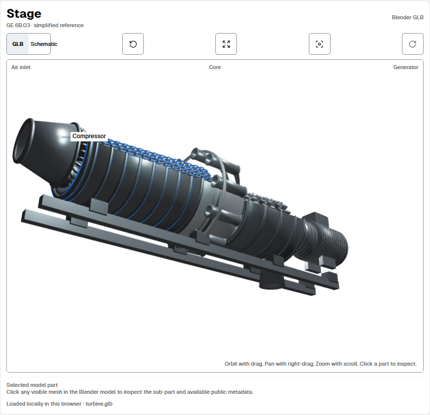
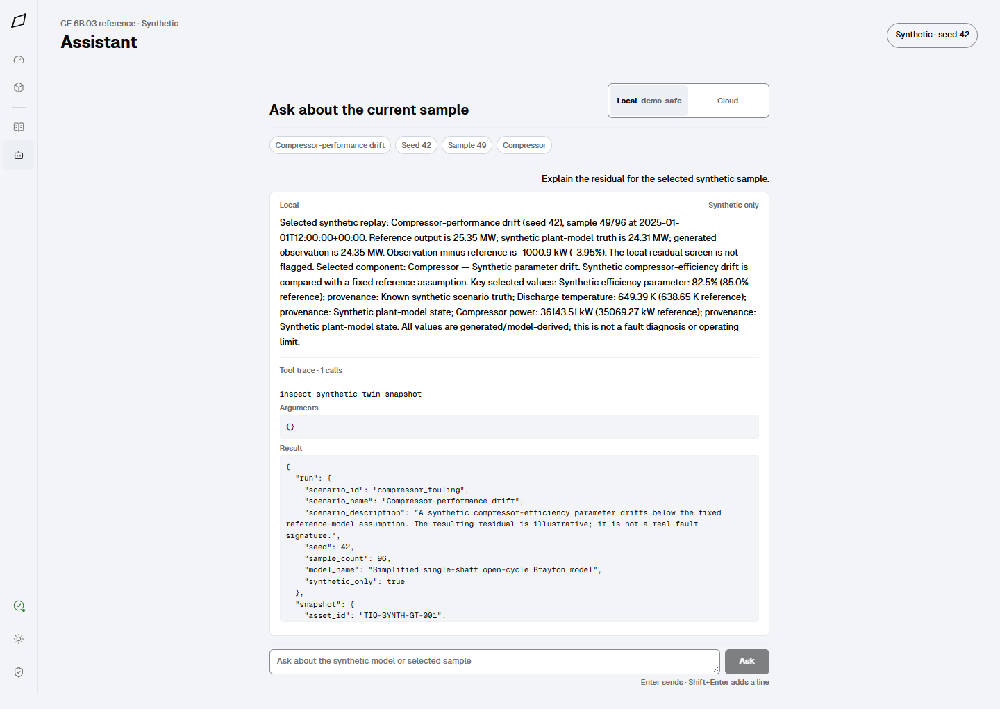

# TurbineIQ

TurbineIQ is a local-first prototype for exploring a simplified, single-shaft, open-cycle industrial gas turbine. Its primary interface is a React and Three.js engineering workspace backed by a local FastAPI service and deterministic Python modules. The workspace brings together a simplified Brayton-cycle reference, reproducible synthetic scenarios, data-quality screening, cited local document search, and a bounded assistant.

The project includes an interactive synthetic-twin demonstrator. It is not synchronized to a physical turbine and is not an OEM performance model, maintenance authorization system, or control system. No real turbine data, fabricated OEM specifications, live industrial connectivity, DCS/SCADA/PLC control, or confidential FieldCore material is included.

## The workspace

The Overview connects the sample replay, engineering readouts, interactive stage, component ledger, and timeline. Components provides component metrics, trends, and linked evidence. Evidence searches local technical notes. Assistant defaults to deterministic local mode; using a cloud model requires an explicit choice, and sending retrieved excerpts has a separate consent control.





The stage loads the project-authored `frontend/public/models/turbine.glb`. This conceptual Blender visualization is Meshopt-compressed for delivery; an uncompressed glTF export also loads. See [Blender model integration](docs/BLENDER_INTEGRATION.md) for the name-mapping and export contract.

## Run the browser workspace

Requirements: Python 3.11 or newer, Node.js 22 or newer, and npm. Run the API and frontend in separate terminals from the repository root.

### PowerShell

Terminal 1:

```powershell
python -m venv .venv
.\.venv\Scripts\Activate.ps1
python -m pip install -e ".[dev]"
python -m uvicorn turbineiq.api.main:app --host 127.0.0.1 --port 8000
```

Terminal 2:

```powershell
npm ci --prefix frontend
npm run dev --prefix frontend
```

Open the local URL printed by Vite, normally `http://localhost:5173`.

### POSIX shell

Terminal 1:

```sh
python3 -m venv .venv
. .venv/bin/activate
python -m pip install -e '.[dev]'
python -m uvicorn turbineiq.api.main:app --host 127.0.0.1 --port 8000
```

Terminal 2:

```sh
npm ci --prefix frontend
npm run dev --prefix frontend
```

Open the local URL printed by Vite, normally `http://localhost:5173`.

For a single-process preview, run `npm run build --prefix frontend`, then start the API; FastAPI serves `frontend/dist` when that directory exists. The frontend uses the local API at `127.0.0.1:8000` during Vite development.

## Optional interfaces

The earlier Streamlit interface is optional. Install it only when you want to run it:

```sh
python -m pip install -e '.[streamlit]'
streamlit run app.py
```

Cloud model support is also optional. Install `.[cloud]` and configure `.env` only when you choose to use a provider. The deterministic engineering, synthetic data, local evidence retrieval, and local assistant do not require a cloud key. The UI asks before sending a question and tool results; document excerpts require a separate opt-in.

## Verify

Install the Streamlit extra as well as development tools because the Python suite includes tests for the optional Streamlit interface.

PowerShell:

```powershell
python -m pip install -e '.[dev,streamlit]'
ruff check src tests
python -m pytest -q
npm run lint --prefix frontend
npm run build --prefix frontend
npm run test --prefix frontend
npm run check:paths --prefix frontend
npm run test:e2e --prefix frontend
```

POSIX shell:

```sh
python -m pip install -e '.[dev,streamlit]'
ruff check src tests
python -m pytest -q
npm run lint --prefix frontend
npm run build --prefix frontend
npm run test --prefix frontend
npm run check:paths --prefix frontend
npm run test:e2e --prefix frontend
```

Install Chromium with `npx playwright install chromium`. The production E2E run starts a local API automatically. The cloud path is mocked in tests; tests do not need credentials. CI on Linux also installs system packages with `npx playwright install --with-deps chromium`.

## Blender asset

Rebuild the native Blender scene and GLB with Blender installed:

```sh
blender --background --python models/build_ge_6b03_reference.py
```

The exported geometry is a conceptual visualization, not a dimensionally accurate OEM assembly. Publicly sourced reference metadata and its limits are documented in [the public-data review](docs/GE_6B03_PUBLIC_DATA_REVIEW.md). The GLB compression pipeline and required extensions are described in [Blender model integration](docs/BLENDER_INTEGRATION.md).

## Project map

```text
src/turbineiq/engineering/   Simplified cycle calculations and validation
src/turbineiq/synthetic/     Seeded synthetic scenario generation
src/turbineiq/analytics/     Data-quality checks and residual screening
src/turbineiq/twin/          Synthetic-only state and replay data
src/turbineiq/rag/           Local document extraction and retrieval
src/turbineiq/agent/         Single-agent tools and optional cloud adapter
src/turbineiq/api/           Local FastAPI endpoints
src/turbineiq/ui/            Optional earlier Streamlit pages
frontend/src/app/            Hash router and shared reducer/context store
frontend/src/features/       Overview, component, evidence, assistant, and viewer
frontend/src/components/ui/  Shared Sheet and offline banner
frontend/src/lib/            Formatting, API helpers, and shared references
frontend/src/index.css       Design tokens, fonts, and global accessibility styles
docs/                        Scope, architecture, demo, integration, and design guidance
tests/                       Python unit and integration tests
```

For a guided walkthrough, see the [three-minute demo guide](docs/DEMO_GUIDE.md). The [architecture note](docs/ARCHITECTURE.md) describes data flow and frontend module boundaries. The [redesign index](docs/redesign/README.md) collects the direction, phase reports, contrast results, and final visual evidence.
