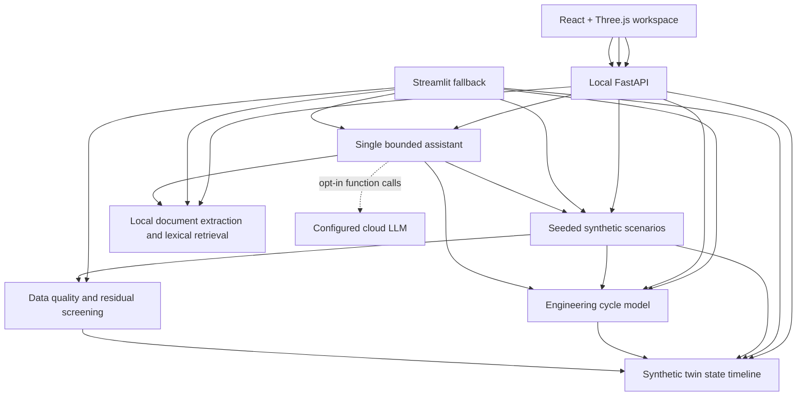

# TurbineIQ architecture

## Runtime shape

The prototype has a React/TypeScript browser workspace backed by a local FastAPI service and deterministic Python modules. The earlier Streamlit interface remains as a local fallback. The optional cloud model can request a small allow-list of local functions; it cannot execute arbitrary code, access the filesystem, or connect to equipment.

## Module responsibilities

- `engineering/` owns validated inputs, four cycle state points, work and heat calculations, fuel estimate, output estimates, and model assumptions. It has no UI, file, or network dependencies.
- `synthetic/` calls the engineering model at each time step and adds seeded ambient variation, measurement noise, and explicit fault labels. It never reads external operating data.
- `analytics/` checks the tabular shape, synthetic labels, timestamps, configured physical validity, flat lines, and robust residual outliers. These are data-quality/screening results, not fault diagnoses.
- `twin/` constructs a synthetic asset record and time-indexed state snapshots from generated scenarios. It compares model output with generated observations and carries the residual screen label; it cannot ingest real telemetry.
- `rag/` extracts text from PDF/Markdown/TXT, chunks it with source and page/section metadata, then performs local lexical ranking and citation formatting. It stores no embeddings or external index.
- `agent/` routes local questions to deterministic functions and optionally runs the Responses API function-calling loop. Function names are allow-listed, requests are capped at three tool rounds, and document retrieval is only offered after the separate UI opt-in.
- `api/` exposes health, scenario catalog, synthetic twin replay, local evidence search, and bounded assistant endpoints. If a selected replay context is supplied, scenario, seed, sample index, and component are validated and recomputed server-side before the assistant uses it.
- `frontend/` composes the API into the React replay workspace, charts, evidence view, and selectable R3F turbine scene. A user-selected Blender GLB remains in browser memory; the default workspace model path is local and ignored by Git.
- `ui/` composes the earlier modules into Streamlit Overview, Cycle analysis, Scenarios & data, Technical documents, and Engineering assistant pages. Uploaded documents are held in Streamlit session memory for the active session.

## Data and trust boundaries

1. Default model assumptions and generated demo records are synthetic/illustrative.
2. Uploaded documents are parsed locally. On the Technical documents page, retrieval and answer construction remain local.
3. In cloud assistant mode, the question, selected server-recomputed synthetic sample context, and outputs from selected tools are sent to the configured provider. Retrieved document excerpts are excluded unless separately approved for that answer.
4. Document text is treated as untrusted evidence. It cannot modify system instructions or expand the tool allow-list.
5. The twin is synchronized only with the local synthetic scenario timeline; no physical asset binding, DCS, SCADA, PLC, live turbine, or maintenance-action interface exists.

## Local state and persistence

There is no database, telemetry service, vector store, or background worker. Scenario frames are generated per request. Uploaded document bytes and chunks live in the current Streamlit session; the app does not write them to disk. Cloud requests set `store=False` and do not maintain provider-side conversation state through this prototype.
