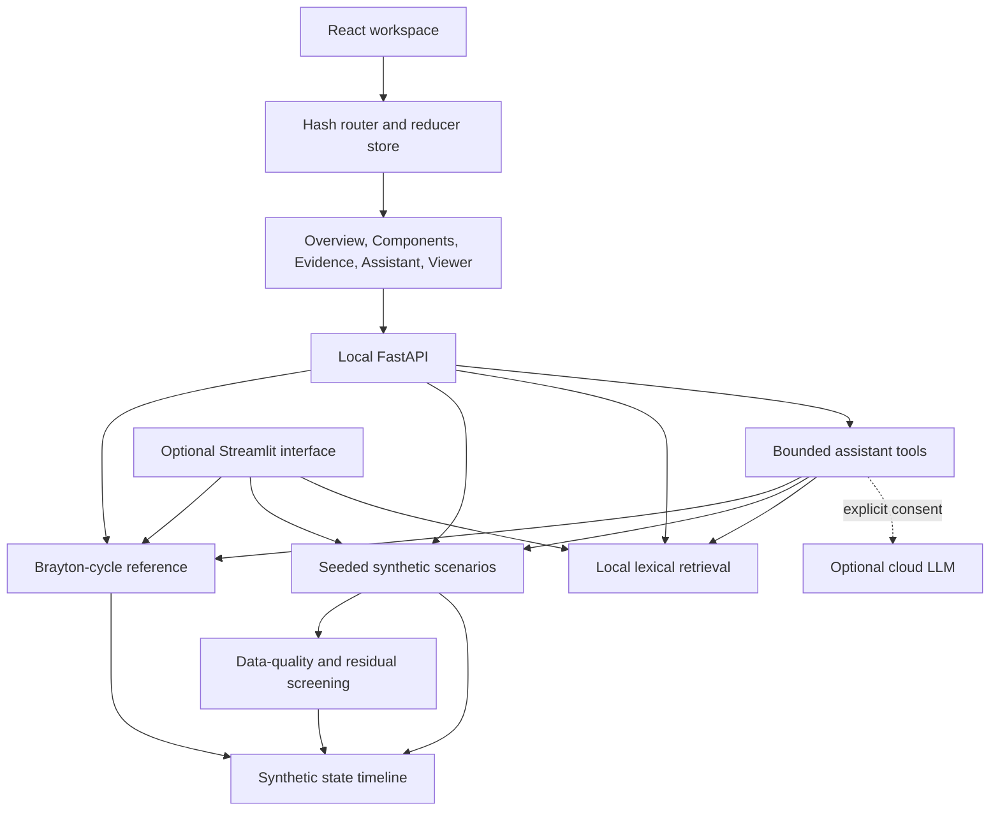

# TurbineIQ architecture

## Runtime shape

The primary application is a React and TypeScript browser workspace served by a local FastAPI process. The API calls deterministic Python engineering, synthetic-data, analytics, retrieval, and assistant modules. The earlier Streamlit interface remains available through an optional Python extra. A cloud language model is an opt-in adapter; local engineering and data processing do not depend on it.

## Python responsibilities

- `engineering/` validates inputs and calculates the simplified cycle states, work, heat, fuel estimate, output estimate, and model assumptions. It has no UI or network dependency.
- `synthetic/` generates seeded sample histories from the engineering model, with explicit scenario perturbation labels and measurement noise. It does not ingest real plant data.
- `analytics/` checks tabular shape, timestamps, configured physical validity, flat lines, and robust residual outliers. Its flags are screening results, not fault diagnoses.
- `twin/` packages synthetic scenario frames into a time-indexed state view. The twin is bound only to generated data.
- `rag/` extracts local PDF/Markdown/TXT content and performs lexical ranking with citation metadata. It uses no remote vector service.
- `agent/` routes questions through a fixed allow-list of deterministic tools. Its optional cloud adapter cannot run arbitrary code or expand the tool list.
- `api/` exposes health, scenario catalog, replay, evidence search, and assistant endpoints. Selected context is validated and recomputed by the server before use.
- `ui/` contains the earlier Streamlit pages. Install the `streamlit` extra to run them.

## Frontend structure

- `frontend/src/app/` owns the hash router, route/query parsing, shared reducer, and context. The URL mirrors route, scenario, seed, sample, and evidence search state.
- `frontend/src/features/` groups screen and domain code: `overview/` contains filters, KPIs, station/component ledgers, replay, charts, and the stage card; `component-detail/`, `evidence/`, and `assistant/` own their route experiences; `viewer/` owns the React Three Fiber scene, GLB loader, schematic, mesh mapping, camera, lighting, and callouts.
- `frontend/src/components/ui/` holds shared UI such as the native-dialog Sheet and engine-offline banner.
- `frontend/src/lib/` contains formatting, local engine state, and the published-reference constant.
- `frontend/src/index.css` defines semantic design tokens, locally bundled Geist fonts, focus treatment, and global theme behavior. Feature CSS consumes those tokens.
- `frontend/src/api.ts` preserves the Python API request and response contract in `frontend/src/types.ts`.

The browser loads `frontend/public/models/turbine.glb` from the local application. Mesh names and the six component IDs form its selection contract. The project asset uses Meshopt compression decoded with the local Three/Drei dependency; the viewer also accepts an uncompressed export.

## Data and trust boundaries

1. Cycle assumptions and demonstration records are synthetic or illustrative.
2. Evidence retrieval and the deterministic local assistant run on the local API.
3. Cloud mode is opt-in. It can send the question, server-recomputed synthetic context, and results from selected tools to the configured provider. Document excerpts require separate per-request consent.
4. Retrieved text is treated as untrusted evidence and rendered as plain text. It cannot change instructions or expand the tool allow-list.
5. No physical turbine binding, real-time industrial connectivity, DCS/SCADA/PLC integration, or control action exists.

## Local state and persistence

There is no database, telemetry service, vector store, or background worker. Scenario frames are generated per request. Streamlit uploads are held in session memory. The browser's URL holds shareable replay and search state. Cloud requests disable provider-side response storage.
