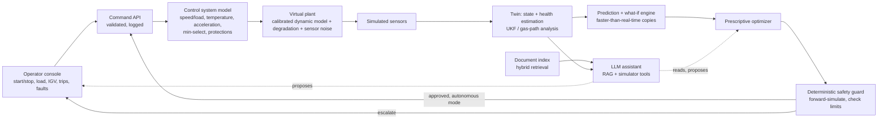

# TurbineIQ thesis roadmap: operable simulation, a self-calibrating twin, and a grounded assistant

Status: proposal, written 2026-11-15. It plans work; nothing here is implemented yet. Assumptions that would change the plan are listed in [Open questions](#11-open-questions-for-the-author-and-supervisor).

## 1. Summary

TurbineIQ is a thesis project, not a product. The examiners will judge it on a clear research question, a defensible method, and validation evidence, not on feature count. This roadmap therefore turns the four wishes (more operator freedom, a real simulation, "beyond DT level 4", and a ChatGPT-like assistant) into one research story:

> A closed-loop digital-twin testbed for a GE 6B-class single-shaft gas turbine, in which a calibrated dynamic "virtual plant" stands in for the physical machine, a separate twin model tracks it by online self-calibration, a prescriptive layer proposes and (inside a verified safety envelope) applies actions, and a tool-grounded LLM assistant explains every number it gives by pointing to a simulator result or a cited document.

Three points shape everything below:

1. **TurbineIQ is not at level 4 today.** On the scale used here (section 2) it is a level 0 (standalone) twin with level 2 (diagnostic) features that run against synthetic replay. "Going beyond level 4" means building levels 3, 4 and 5 in order, and each needs the one below it.
2. **Without a physical turbine, level 5 can only be demonstrated against a simulated plant.** That is a legitimate and common thesis design (software-in-the-loop), but the thesis must say so plainly. Section 3 defines what level 5 means here and how it is tested.
3. **Calibration comes first.** The cycle model gives about 25.5 MW against the published 45 MW for the 6B.03 (PR #4, `GE_6B03_PUBLIC_DATA_REVIEW.md`). Every later claim (transients, degradation estimates, fuel savings, assistant answers) inherits that error. Phase 1 fixes it before anything is built on top.

## 2. Maturity framework used

Digital-twin "levels" are not standardized; different sources use 3, 4, 5 or 6 levels with different meanings. This roadmap uses the **capability-level scale associated with DNV's recommended practice DNVGL-RP-A204, *Qualification and assurance of digital twins* (DNV GL, 2020)**, as adopted and stated in Stadtmann, Wassertheurer and Rasheed (2023) and Sundby et al. (2021). It fits this project because it is used in energy-asset twins and because its level 4/5 boundary is exactly the "prescriptive vs autonomous" step the author asked about.

| Level | Name | Definition (as quoted in Stadtmann et al., 2023) | TurbineIQ today |
| --- | --- | --- | --- |
| 0 | Standalone | "a representation of a physical asset that has no real-time data connection to the asset" | **Yes.** No physical asset. |
| 1 | Descriptive | "adds real-time updates through sensors to the model and thus describes the physical asset at any given point in time" | Only against a pre-generated synthetic replay, not a running plant. |
| 2 | Diagnostic | "enhanced with analysis tools that notify the user about unusual asset behavior and help with troubleshooting" | Partly: data-quality checks, residual screen, CUSUM drift (PR #2). |
| 3 | Predictive | "aims at estimating the future state of the system to support operation, maintenance, and more" | No. |
| 4 | Prescriptive | "provides recommendations based on what-if scenarios and risk analysis and thereby aids with decision support" | No. |
| 5 | Autonomous | "replaces the human in the loop" | No. |

The thesis should also cite Kritzinger et al. (2018), whose distinction between a digital *model* (no automatic data flow), *shadow* (one-way) and *twin* (two-way) is the standard objection an examiner will raise. The testbed in section 4 is designed so that the twin has two-way data flow with the virtual plant, which answers that objection inside the simulated setting.

Alternative framework if the supervisor prefers one: Madni, Madni and Lucero (2019) use four levels (pre-digital twin, digital twin, adaptive, intelligent). Pick one framework and use it consistently; do not mix numbering from different sources.

## 3. What "level 5" means here, concretely, and how it is validated

### 3.1 Definition for this thesis

The twin operates at level 5 for a defined task set when, against the virtual plant, it:

1. **Synchronizes**: estimates the plant's current state and health parameters from noisy simulated sensors only (it does not read the plant's internal truth).
2. **Self-calibrates**: updates its own model parameters online (e.g. compressor flow capacity and efficiency deltas, turbine efficiency delta) as the plant degrades.
3. **Predicts**: forecasts the next hours of performance and degradation with an uncertainty band.
4. **Prescribes**: ranks candidate actions (load setpoint change, compressor offline wash timing, IGV/exhaust-temperature schedule bias within limits) by a stated objective (fuel cost, heat rate, life consumption proxy) using what-if runs.
5. **Acts autonomously within an envelope**: applies the chosen action to the virtual plant without a human, only if a deterministic guard verifies it against hard limits on a forward simulation first; otherwise it escalates to the human. The LLM never sits in this loop (section 7.4).

The "task set" matters: autonomy is claimed for named tasks (for example, "hold heat-rate-optimal load under ambient swings and compressor fouling") and not for the whole machine. A claim of general autonomy would not be defensible.

### 3.2 Validation protocol

Each claim is tested against injected ground truth that only the virtual plant knows.

| Capability | Metric | Example pass criterion (to agree with supervisor) |
| --- | --- | --- |
| Synchronization | RMS error of twin outputs vs plant truth (power, exhaust T, compressor discharge p/T) | Within sensor noise band after convergence |
| Self-calibration | Error of estimated health parameters vs injected degradation; convergence time | Fouling efficiency loss estimated within ±0.3 points |
| Diagnosis | Detection delay, false-alarm rate, missed detections over a seeded scenario bank | Earlier than the current CUSUM/MAD screen at equal false-alarm rate |
| Prediction | Forecast error and calibration of the uncertainty band (coverage) | 90% band covers ~90% of outcomes |
| Prescription | Benefit vs a fixed baseline policy (fuel, heat rate), counted over the scenario bank | Positive benefit with confidence interval excluding zero |
| Autonomy | Hard-limit violations; share of decisions taken without escalation; behaviour under twin–plant model mismatch | Zero violations; graceful escalation when mismatch is large |

The key experiment is **deliberate model mismatch**: the plant and twin must not be the same code with the same parameters, or the result is circular. Options: the plant uses the higher-fidelity calibrated model (variable properties, cooling flows) and the twin a reduced model; or the plant is an independent tool (OpenModelica/ThermoPower) and the twin is TurbineIQ's Python model.

## 4. Target architecture

Design rules:

- **One deterministic simulation core**, seeded and event-logged, so every run (including an operator session) can be replayed exactly. Reproducibility is a thesis asset.
- **Plant and twin are separate objects** even if they share code, with separate parameters and no access to each other's internal state.
- **The LLM proposes; deterministic code decides and verifies.**
- The scope document (`PROJECT_SCOPE.md`) must be updated: operator control of a *simulated* plant becomes in scope; control of real equipment stays out of scope.

## 5. Work packages

### WP1 — Calibrate the steady-state model to the published 6B.03 point (prerequisite)

Why first: section 1, point 3. PR #4 already showed a constant-cp model cannot match output, efficiency, exhaust temperature and exhaust flow together.

Method:

- Replace constant cp/gamma with temperature- and composition-dependent properties (NASA 7-coefficient polynomials, or Cantera for air and combustion products), and make the combustor energy balance consistent (currently heat input uses `cp_air` while the turbine uses `cp_gas`).
- Add turbine cooling/leakage bleed (as fractions of compressor flow), inlet and exhaust pressure losses, and fuel mass added to turbine flow.
- Fit a small set of physically bounded parameters to the published ISO targets: 45 MW, 33.4% LHV efficiency, 12.8 pressure ratio, 561 °C exhaust, 145.1 kg/s exhaust flow (GE Vernova 2025 catalog, already cited in `GE_6B03_PUBLIC_DATA_REVIEW.md`). Five targets with roughly five free parameters is a near-exact fit, so it is not validation by itself.
- **Validate on data not used for fitting**: the shape of GE's published generic ambient-temperature correction curves for heavy-duty single-shaft machines (GER-3567, *GE Gas Turbine Performance Characteristics*) and part-load trends. State the residuals honestly.
- Report parameter uncertainty (e.g. bounds or a simple Bayesian/bootstrapped fit) so later results can carry an error band.
- Cross-check one operating point against an independent tool: pyCycle (Hendricks and Gray, 2019) or TESPy (Witte and Tuschy, 2020).

Deliverable: calibrated `engineering/` model, a calibration report, updated `engineering/reference.py` and the frontend caveat, and the guard test from PR #4 changed from "uncalibrated" to a tolerance check.

### WP2 — Dynamic simulation core

Recommended base: **Rowen's simplified model of heavy-duty single-shaft gas turbines** (Rowen, 1983), which was derived for GE heavy-duty machines and is the basis of many power-system GT models (see the IEEE PES technical report on turbine-governor models, 2013). It already contains what operator controls need: speed/load (droop or isochronous) control, temperature control on exhaust temperature, acceleration control, a minimum-value select producing fuel stroke reference, fuel-system lags, rotor inertia, and exhaust thermocouple dynamics. Rowen's 1992 extension adds IGV behaviour.

Steps:

- Implement the Rowen block structure as a fixed-step ODE system in Python (SciPy, or a hand-written RK4 for determinism and speed).
- **Replace Rowen's generic static functions** (torque and exhaust temperature vs fuel and speed) with lookups generated from the WP1 calibrated cycle model. This couples the dynamic model to the calibrated thermodynamics and is a small, defensible contribution in itself.
- Add start-up sequence states (crank, purge, ignition, warm-up, accelerate, full-speed-no-load, synchronize, load) as a state machine with illustrative timings marked as such.
- Add protections as trips: overspeed, exhaust over-temperature, flame loss, and a manual emergency trip. Thresholds are illustrative and labelled; no OEM limits are invented.
- Add a grid model option: infinite bus, or an isolated load with frequency response.
- Run server-side; stream state at 10–20 Hz over WebSocket/SSE; support faster-than-real-time for what-if runs.

Validation: reproduce the qualitative step responses in Rowen (1983) and in later studies that implemented it for GE frame machines; check steady-state endpoints match WP1 at every load; check energy balance in transients; unit tests for each trip.

Optional cross-check: build the same plant in OpenModelica with the ThermoPower library (Casella and Leva) for an independent model, which is also the cleanest way to get model mismatch for section 3.2.

### WP3 — Operator console ("more freedom")

- Controls: start, normal stop, emergency trip, load setpoint with ramp-rate limit, droop/isochronous mode, IGV manual/auto (manual only in a "training" mode), temperature-control bias, ambient conditions, grid events.
- Fault/degradation injection panel: compressor fouling, turbine erosion, sensor drift/stuck/noise, fuel-valve lag, thermocouple failure. This is how the user creates test cases for WP4–WP5 and is also the basis of the validation scenario bank.
- Every command goes through a validated command API and is written to an event log; any session can be replayed.
- Visual feedback in the existing Three.js stage: rotor speed, flame state, heat colouring by temperature, trip state.
- Training mode (optional, creative): scripted drills (e.g. "load reject at 80% load", "exhaust thermocouple spread alarm") with scoring. Useful for a demo, low research value.

### WP4 — Predictive and self-calibrating twin (levels 1–3 done properly)

- Health parameters per component (flow capacity and isentropic efficiency deltas), the standard gas-path-analysis formulation (Li, 2002; Walsh and Fletcher, *Gas Turbine Performance*).
- Online estimation with an Unscented Kalman Filter or moving-horizon estimation over the WP2 model; FilterPy or a small in-house implementation.
- Compare against the existing residual screen and PR #2's CUSUM detector on the same seeded scenarios.
- Prediction: propagate the estimated state and degradation rate forward with uncertainty (ensemble of what-if runs).
- Optional data-driven comparison: a small ML surrogate or anomaly detector trained on synthetic data and checked on a real public dataset (section 8) to show it transfers, or honestly report that it does not.

### WP5 — Prescriptive and autonomous layer (levels 4–5)

- Decision problems with clear objectives, for example: (a) choose load setpoint under ambient changes to minimize heat rate while meeting a demand band; (b) schedule an offline compressor wash given fouling rate, fuel cost and downtime cost; (c) respond to a degraded thermocouple by switching to a model-based exhaust estimate.
- Method: what-if enumeration over a small action set first (transparent, enough for a thesis), then optionally model predictive control with CasADi or do-mpc if time allows.
- Safety guard: every candidate action is simulated forward on the twin, checked against hard limits and rate limits; any violation or high model mismatch means escalate to the operator. Log every decision with its reason.
- Autonomy modes on the console: manual, advisory (level 4: recommendations only), autonomous (level 5: applied after guard approval). The comparison between advisory and autonomous modes over the scenario bank is the core results chapter.

### WP6 — LLM assistant with RAG and simulator tools ("like ChatGPT")

What changes from today: the current retriever is lexical over a single demo note (`data/documents/demo_cycle_notes.md`), so retrieval has almost nothing to find. The work is as much about the corpus and evaluation as about the model.

- **Corpus**: public material only, kept with its source and licence noted: GE GER technical papers (GER-3567, GER-4217B, and others), NASA/DOE public reports, open-access papers, and the author's own thesis notes. Copyrighted textbooks or paywalled papers can be indexed locally from the author's own copies but must not be committed to the repository. Leaked or confidential manuals stay excluded, as already decided in `GE_6B03_PUBLIC_DATA_REVIEW.md`.
- **Retrieval**: hybrid BM25 + dense embeddings with reciprocal-rank fusion and a cross-encoder reranker. Local, open models keep it offline-capable: embeddings such as BAAI `bge-m3` or `nomic-embed-text` (via sentence-transformers or Ollama), reranker such as `bge-reranker-v2-m3`. Store: Chroma, LanceDB or Qdrant (embedded mode); at this corpus size FAISS or even NumPy is enough, so choose for simplicity. Keep page/section citations, which the current pipeline already supports.
- **Tools into the simulator**: `get_live_state`, `run_what_if` (copy current state, apply action, simulate N minutes, return summary), `explain_trip` (event log around a trip), `estimate_health`, `compare_scenarios`, `recommend_action` (calls WP5, returns guard verdict). Tool outputs are the only allowed source of numbers; PR #5's numeric-traceability check enforces that.
- **Conversation**: multi-turn memory of the session, streaming responses (the roadmap in the 2026-11-14 review lists real token streaming as open), and visible tool traces (already present in the UI).
- **Models**: keep the existing provider-neutral adapter (Groq/Cerebras/OpenRouter/Ollama/OpenAI). For an offline thesis demo, a local model via Ollama avoids sending anything out.
- **Evaluation** (this is what turns a feature into a contribution): a fixed benchmark of, say, 100–200 questions in categories (factual from documents, numeric from simulator, causal "why did it trip", prescriptive "what should I do"), each with a reference answer or reference tool result. Compare configurations: no retrieval, RAG only, tools only, RAG + tools. Measure answer correctness, numeric faithfulness (PR #5 check), citation precision/recall, and refusal when evidence is missing. RAGAS (Es et al., 2023) provides standard RAG metrics; numeric and tool-correctness checks should be your own deterministic scripts. Retrieval-augmented generation is introduced in Lewis et al. (2020).

### WP7 — Other ideas, ranked by thesis value

| Idea | Value | Note |
| --- | --- | --- |
| Uncertainty bands on every displayed model number | High | Directly supports calibration and prediction chapters. |
| Counterfactual "branch from now" in the UI | High | Same engine as `run_what_if`; makes level 4 visible. |
| Emissions estimate (NOx/CO correlation) | Medium | Adds an objective for prescription; validate trends against the UCI emissions dataset. |
| Grid frequency event response | Medium | Classic use of Rowen-type models; easy to validate qualitatively. |
| Operator training drills with scoring | Low–medium | Good demo, little research content. |
| Combined-cycle extension (HRSG + steam turbine) | Low for this thesis | Large effort; a future-work item. |
| Fleet of several units | Low | Future work. |
| More Blender/visual polish | Low | Already strong; stop here unless the thesis is in visualization. |

## 6. Research contributions and research questions

Pick **one primary contribution** according to the thesis domain; the others become supporting chapters or future work.

- **C1 (prerequisite, all domains):** a transparent, open, GE 6B-class performance and dynamic model calibrated only to public data, with quantified residuals and uncertainty.
- **C2 (mechanical/energy focus):** a closed-loop, software-in-the-loop digital-twin testbed demonstrating levels 3–5 on the DNV scale, with self-calibration and a verified autonomy envelope, evaluated against injected degradation and model mismatch.
- **C3 (AI/CS focus):** an evaluation of tool-grounded LLM assistance for gas-turbine operation, showing whether simulator tools and retrieval improve numeric faithfulness and citation accuracy over retrieval alone.

Candidate research questions:

- **RQ1.** How closely can a variable-property cycle model calibrated only to public data reproduce the published 6B.03 ISO point and GE's generic ambient correction trends, and what is the remaining uncertainty?
- **RQ2.** Does online health-parameter estimation keep the twin within sensor-noise tracking error under injected compressor fouling and turbine erosion, and does it detect degradation earlier than residual and CUSUM screens at an equal false-alarm rate?
- **RQ3.** Under twin–plant model mismatch, what measurable benefit does a prescriptive layer give over a fixed policy, and can autonomous operation be bounded with zero hard-limit violations?
- **RQ4.** For gas-turbine operator questions, does an LLM with simulator tools and hybrid retrieval answer more correctly and more faithfully (numbers traced, citations correct) than retrieval alone?

## 7. Risks and honest limitations

1. **Circular validation.** If plant and twin share code and parameters, "perfect tracking" proves nothing. Mitigation: section 3.2 model mismatch.
2. **No real 6B.03 transient data is public.** Dynamic validation is qualitative against literature and internally consistent, not against the real machine. State it.
3. **Public data is thin.** One ISO point plus generic curves cannot identify everything; report which parameters are identifiable.
4. **LLM in a control loop.** Never let generated text become a command without the deterministic guard. This is also a good discussion section.
5. **Scope creep.** Seven work packages is too many to finish to thesis standard in a few months. Section 9 orders them; cut from the bottom.
6. **Copyright and confidentiality** of documents in the RAG corpus (WP6).

## 8. Validation data and benchmarks

| Source | What it is | Use here | Caveat |
| --- | --- | --- | --- |
| GE Vernova 2025 Gas Power catalog, 6B.03 rows | Published ISO ratings | WP1 calibration targets | Net plant, ISO, natural gas only. |
| GE GER-3567 *Gas Turbine Performance Characteristics* | Generic ambient/part-load correction curves | WP1 held-out validation of trends | Generic heavy-duty, not 6B.03-specific. |
| GE GER-4217B *Uprate Options for the MS6001* | Family architecture | Model structure, RAG corpus | Family-level. |
| Rowen (1983) and implementations in later papers | Published dynamic responses | WP2 qualitative transient validation | Generic parameters. |
| UCI *Gas Turbine CO and NOx Emission Data Set* (Kaya, Tüfekci and Uzun, 2019) | ~37k hourly records, 11 sensor variables, a real gas turbine in Turkey, 2011–2015 | Real-data check for steady-state trends, surrogate models, emissions | Different (larger, combined-cycle) unit; hourly averages, no transients. |
| UCI *Combined Cycle Power Plant* (Tüfekci, 2014) | Ambient conditions vs net output | Ambient-sensitivity trend check | Whole plant, not GT alone. |
| UCI *Condition Based Maintenance of Naval Propulsion Plants* (Coraddu et al., 2016) | Simulated gas-turbine data with compressor and turbine decay coefficients | Benchmark for health-parameter estimation (WP4) | Simulated, marine LM2500-class, not industrial heavy-duty. |
| NASA C-MAPSS / N-CMAPSS (Saxena et al., 2008; Arias Chao et al., 2021) | Turbofan run-to-failure simulations | Benchmark prognostic methods, if a prognostics chapter is added | Aero engine; methods transfer, numbers do not. |
| Own seeded scenario bank (WP3 injection) | Ground-truth degradation and faults | Main experiments for RQ2–RQ3 | Synthetic by construction. |
| Own assistant benchmark (WP6) | Question set with reference answers/tool results | RQ4 | Must be written before tuning the assistant, to avoid overfitting. |

## 9. Prioritization and phased timeline

Value is thesis value (answers an RQ or is needed by one); effort is a rough estimate for one person.

| Item | Thesis value | Effort | Depends on |
| --- | --- | --- | --- |
| WP1 calibration | Very high (everything depends on it) | 2–3 weeks | — |
| Merge or close PRs #2–#5 | High (removes known defects) | Days | — |
| WP2 dynamic core | Very high | 3–4 weeks | WP1 |
| WP3 console, minimal (start/stop/load/trip/fault injection) | High | 2 weeks | WP2 |
| WP4 estimation and prediction | Very high for C2 | 3–4 weeks | WP2, WP3 injection |
| WP5 prescription + guard + autonomy | Very high for C2 | 3–4 weeks | WP4 |
| WP6 retrieval upgrade + simulator tools | High for C3, medium for C2 | 2–3 weeks | WP2 for tools |
| WP6 evaluation benchmark | Very high for C3 | 2 weeks | WP6 |
| WP3 training drills, WP7 extras | Low–medium | Variable | — |
| Writing | Required | 4–6 weeks, overlapping | All |

Phased timeline, assuming about 24 weeks from now and a mechanical/energy (C2) focus; shift weight to WP6 for an AI/CS (C3) focus. Replace week numbers with dates once the deadline is known.

| Phase | Weeks | Outcome | Maturity reached |
| --- | --- | --- | --- |
| 0. Clean base | 1 | PRs #2–#5 merged or closed; scope doc updated; scenario bank defined | — |
| 1. Calibration | 2–4 | Calibrated model, calibration report (RQ1 answered) | 0, credible |
| 2. Dynamics + console | 5–10 | Operable virtual plant with start/stop/load/trips/faults, streaming, replay | 1 (twin follows a live plant) |
| 3. Estimation + prediction | 11–15 | Self-calibrating twin; detection benchmark (RQ2) | 2–3 |
| 4. Prescription + autonomy | 16–19 | Advisory vs autonomous experiments (RQ3) | 4–5 |
| 5. Assistant | 12–20, in parallel | Hybrid RAG, simulator tools, benchmark (RQ4) | — |
| 6. Writing + freeze | 18–24 | Code freeze at week 20; thesis draft; demo script | — |

## 10. First implementable steps

### Step 1 — Variable-property cycle model and calibration report (WP1)

- Add a property module (NASA polynomials or Cantera) and a `CalibratedCycle` path next to the existing constant-cp solver, so the old model remains for comparison.
- Add cooling bleed fraction, inlet/exhaust losses, fuel mass flow into the turbine, consistent combustor energy balance.
- Fit with `scipy.optimize.least_squares` within physical bounds to the five ISO targets; write the fitted values and residuals to `docs/evidence/calibration/`.
- Check held-out ambient-temperature trend against GER-3567; cross-check one point in pyCycle or TESPy.
- Acceptance: all five ISO targets within an agreed tolerance (e.g. ±1%); ambient trend residuals reported; tests updated.

### Step 2 — Minimal Rowen-type dynamic core with a command API (WP2 + WP3)

- `simulation/` package: state vector (speed, fuel stroke, exhaust T measured, IGV), Rowen control blocks, fixed-step integrator, static maps generated from Step 1.
- Commands: `start`, `stop`, `trip`, `set_load(MW, ramp)`; protections: overspeed and exhaust over-temperature trips with labelled illustrative thresholds.
- Seeded, event-logged sessions; endpoint to create a session, send commands and stream state.
- Acceptance: steady states match Step 1 within tolerance at 25/50/75/100% load; load-step and trip responses qualitatively match Rowen (1983); replaying an event log reproduces the run bit-for-bit.

### Step 3 — Corpus and assistant benchmark before the RAG upgrade (WP6)

- Collect 10–20 public documents with source and licence notes; ingest with the existing pipeline.
- Write the benchmark questions and reference answers first, run them on the current lexical assistant to get a baseline, then add dense retrieval and reranking and measure the change.
- Acceptance: a baseline report and an improved report from the same benchmark, committed as evidence.

Step 3 is independent of Steps 1–2 and can run in parallel if the thesis has an AI/CS focus.

## 11. Open questions for the author and supervisor

The answers can change the priorities above:

1. **Deadline.** The timeline assumes about 24 weeks. A shorter deadline means dropping WP5's autonomous mode to "advisory only" (level 4) and stating level 5 as future work.
2. **Domain and degree.** Mechanical/energy engineering favours C2 (physics, estimation, control). AI/CS favours C3 (LLM, retrieval, evaluation) with a lighter simulation.
3. **Supervisor requirements.** Required frameworks, tools (e.g. MATLAB/Simulink instead of Python/Modelica), datasets, or a specific maturity scale.
4. **Access to any real data** (even anonymized, from an internship or plant). Real data would change the validation story substantially and would need its own confidentiality rules.

## References

- Arias Chao, M., Kulkarni, C., Goebel, K., and Fink, O. (2021). Aircraft engine run-to-failure dataset under real flight conditions for prognostics and diagnostics. *Data*, 6(1), 5.
- Casella, F., and Leva, A. ThermoPower Modelica library. https://github.com/casella/ThermoPower
- Coraddu, A., Oneto, L., Ghio, A., Savio, S., Anguita, D., and Figari, M. (2016). Machine learning approaches for improving condition-based maintenance of naval propulsion plants. *Proc. IMechE Part M*, 230(1). Dataset: UCI Machine Learning Repository.
- DNV GL (2020). *DNVGL-RP-A204: Qualification and assurance of digital twins*. Recommended practice.
- Es, S., James, J., Espinosa-Anke, L., and Schockaert, S. (2023). RAGAS: Automated evaluation of retrieval augmented generation. arXiv:2309.15217.
- GE. *GER-3567: GE Gas Turbine Performance Characteristics*. GE Power Systems.
- GE. *GER-4217B: Uprate Options for the MS6001 Heavy-Duty Gas Turbine*.
- GE Vernova (2025). *Gas Power catalog*, 6B.03 tables. (Link in `GE_6B03_PUBLIC_DATA_REVIEW.md`.)
- Hendricks, E. S., and Gray, J. S. (2019). pyCycle: A tool for efficient optimization of gas turbine engine cycles. *Aerospace*, 6(8), 87.
- IEEE PES (2013). *Dynamic Models for Turbine-Governors in Power System Studies*. Technical report PES-TR1.
- Kaya, H., Tüfekci, P., and Uzun, E. (2019). Predicting CO and NOx emissions from gas turbines: novel data and a benchmark PEMS. *Turkish Journal of Electrical Engineering and Computer Sciences*, 27(6). Dataset: https://archive.ics.uci.edu/dataset/551/gas+turbine+co+and+nox+emission+data+set
- Kritzinger, W., Karner, M., Traar, G., Henjes, J., and Sihn, W. (2018). Digital twin in manufacturing: A categorical literature review and classification. *IFAC-PapersOnLine*, 51(11), 1016–1022.
- Lewis, P., et al. (2020). Retrieval-augmented generation for knowledge-intensive NLP tasks. *NeurIPS 2020*.
- Li, Y. G. (2002). Performance-analysis-based gas turbine diagnostics: A review. *Proc. IMechE Part A*, 216(5), 363–377.
- Madni, A. M., Madni, C. C., and Lucero, S. D. (2019). Leveraging digital twin technology in model-based systems engineering. *Systems*, 7(1), 7.
- Rowen, W. I. (1983). Simplified mathematical representations of heavy-duty gas turbines. *Journal of Engineering for Power*, 105(4), 865–869.
- Rowen, W. I. (1992). Simplified mathematical representations of single shaft gas turbines in mechanical drive service. ASME paper 92-GT-22.
- Saxena, A., Goebel, K., Simon, D., and Eklund, N. (2008). Damage propagation modeling for aircraft engine run-to-failure simulation. *PHM 2008*.
- Stadtmann, F., Wassertheurer, H. G., and Rasheed, A. (2023). Demonstration of a standalone, descriptive, and predictive digital twin of a floating offshore wind turbine. arXiv:2304.01093.
- Sundby, T., Graham, J. M., Rasheed, A., Tabib, M., and San, O. (2021). Geometric change detection in digital twins. *Digital*, 1, 111–129.
- Tüfekci, P. (2014). Prediction of full load electrical power output of a base load operated combined cycle power plant using machine learning methods. *International Journal of Electrical Power & Energy Systems*, 60, 126–140.
- Walsh, P. P., and Fletcher, P. (2004). *Gas Turbine Performance* (2nd ed.). Blackwell.
- Witte, F., and Tuschy, I. (2020). TESPy: Thermal Engineering Systems in Python. *Journal of Open Source Software*, 5(49), 2178.

Bibliographic details for items not opened while writing this roadmap (all except Stadtmann et al. 2023, the DNV citation as printed there, the GE catalog and GER-4217B already reviewed in this repository, and the UCI dataset page) were written from memory and should be checked against the originals before they go into the thesis.
